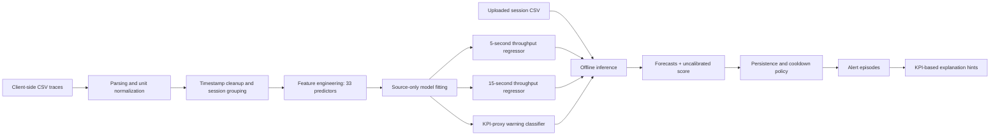

# Architecture

## Data flow

1. Read session CSV and normalize known column aliases.
2. Convert source bitrate fields to Mbps and parse timestamps.
3. Sort and deduplicate timestamps, then build 33 sample/history predictors.
4. Fit two regression models and one KPI-proxy classifier using the frozen 61-session training set.
5. For an uploaded session, produce 5s/15s forecasts and an uncalibrated warning score.
6. Apply the configured threshold, consecutive-positive requirement and cooldown to group alert episodes.
7. Attach explanation hints only when the corresponding KPI is available; mark unavailable ping/loss explicitly.

## Boundaries

The diagram describes an offline CSV workflow. There is no live gNB, O-RAN, Kafka or operator telemetry connector.
