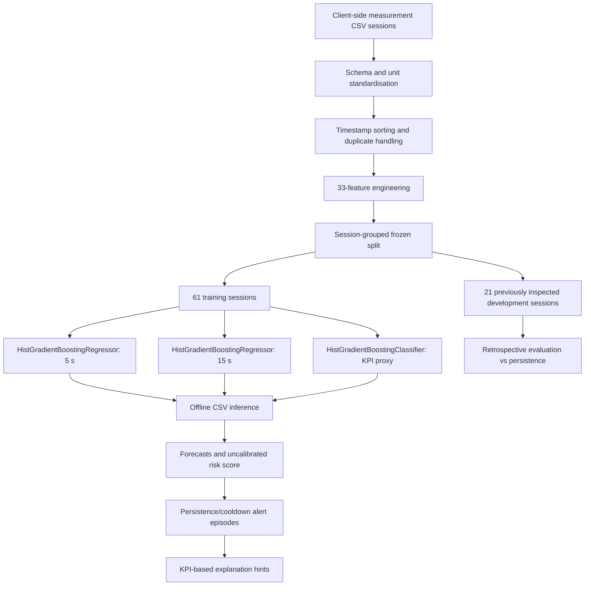

# 5G Network Intelligence (V6.6)

**Offline AI prototype for short-horizon downlink throughput forecasting, KPI-derived degradation warning, and rule-based diagnostic hints.**

> **Scope statement:** This is a reproducible offline research/portfolio prototype built from client-side measurement traces. It is not a live 5G operator monitoring system, does not ingest gNB/O-RAN counters, and does not identify operator-confirmed incidents or root causes.

## What it does

- Parses session-level 5G client measurement CSVs.
- Engineers 33 predictors from throughput, radio measurements, mobility, ping/loss fields and sample-window history.
- Forecasts downlink throughput at nominal 5-second and 15-second horizons.
- Produces a classifier score for a KPI-derived degradation proxy.
- Groups consecutive threshold-positive rows into alert episodes.
- Emits KPI-based explanation hints while marking missing measurements and unverified causes.
- Provides an offline uploaded-CSV inference workflow through a Colab notebook/dashboard.

## Key results (V6.6)

### Throughput forecasting

The 21-session development partition was inspected during earlier V5/V6 development. These are **development results, not untouched final-test results**.

| Horizon | Rows | Model MAE | Persistence MAE | MAE improvement | Model RMSE | Model R² |
|---|---:|---:|---:|---:|---:|---:|
| 5 s | 38,692 | 10.407 Mbps | 12.790 Mbps | +18.63% | 27.962 Mbps | 0.534 |
| 15 s | 38,431 | 12.026 Mbps | 13.265 Mbps | +9.34% | 31.658 Mbps | 0.411 |

### KPI-proxy warning classification

| Metric | Result |
|---|---:|
| Rows | 34,928 |
| Sessions | 21 |
| Proxy prevalence | 9.72% |
| ROC-AUC | 0.864 |
| Average precision (PR-AUC) | 0.432 |
| Precision at score threshold 0.50 | 0.366 |
| Recall at threshold 0.50 | 0.701 |
| F1 at threshold 0.50 | 0.481 |

The target is a proxy derived from low downlink throughput plus weak RSRP or SNR, sustained for at least 3 seconds, with onset in the next 10 seconds. It is **not** an operator-confirmed fault label. The score is **not calibrated as a probability**.

### External transfer

A separate NordicDat transfer experiment (V6.5.1) underperformed the persistence baseline at both horizons. That negative result is retained as evidence of domain-shift/generalisation limitations. NordicDat was not used to fit or tune the V6.6 models.

## Architecture



## Repository layout

```text
.
├── README.md
├── requirements.txt
├── notebooks/
│   └── 5G_Network_Intelligence_V6_6_Final_Audit.ipynb
├── models/
│   ├── forecast_5s.joblib
│   ├── forecast_15s.joblib
│   └── degradation_risk_model.joblib
├── results/
│   ├── v6_6_forecast_summary.csv
│   ├── v6_6_warning_proxy_metrics.csv
│   ├── v6_6_per_session_forecast.csv
│   └── ...
├── sample_data/
│   ├── smoke_test_original_format.csv
│   ├── smoke_test_predictions.csv
│   └── smoke_test_alerts.csv
└── docs/
    └── V6_6_Final_Audit_Report.md
```

## Run it in Google Colab

1. Download `notebooks/5G_Network_Intelligence_V6_6_Final_Audit.ipynb`.
2. Upload it to Google Colab.
3. Put the original `5G-production-dataset.zip` in the root of Google Drive (`MyDrive`). The dataset is not redistributed in this repository; obtain it from its original source and comply with its terms.
4. Run the notebook cells from top to bottom.
5. Outputs and trained models are written to `MyDrive/5G_Network_Intelligence_V6_6/`.
6. The final Gradio launch cell is designed for Colab. It was syntax-checked but was not launched during the local reference execution.

## Reproducibility notes

- Source archive SHA-256: `abc729d696b5e0ba34a9c6ed35a851f2868d2b5071be5efb8a49691c23bb1a9b`.
- 83 CSV files in archive; 82 eligible sessions.
- Frozen split: 61 train / 21 development; seed 42; `GroupShuffleSplit(test_size=0.25)`.
- Three HistGradientBoosting models: two regressors and one classifier.
- Forecast target: first observation at or after the nominal horizon, with maximum 2.5-second overshoot.
- Rolling features are sample-window-based, not guaranteed elapsed-time windows.

## Limitations

- The 21-session development partition was inspected during earlier development; it is not an untouched test set.
- Data are client-side measurement traces, not operator gNB counters.
- No CPU/memory counters or operator-confirmed incident labels are available.
- Warning labels are KPI-derived proxies; risk scores are uncalibrated.
- Alert explanations are hypotheses, not verified root causes.
- The NordicDat external transfer experiment underperformed persistence, indicating poor cross-domain transfer.
- The pipeline processes uploaded CSVs offline. No Kafka, O-RAN, gNB, or live operator integration is implemented.

## Suggested citation

If you use this repository, cite it as a portfolio prototype and cite the original measurement dataset separately using the citation supplied by its publisher. Do not cite this repository as the source of the underlying measurements.
